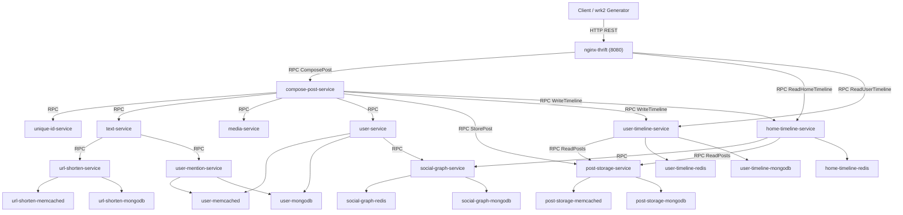

# Tâche 3 : Déploiement, Topologie, Charge Contrôlée, Benchmark Équilibré et Collecte Multimodale (DeathStarBench)

Ce document formalise la réalisation intégrale des 5 étapes de la **Tâche 3** définies dans le cahier des charges du PFE Master SII (* USTHB / SII *).

---

## 1. Déploiement du Backend Microservices & de l'Observabilité

Le système déployé est **DeathStarBench Social Network** couplé à une pile d'observabilité complète (Prometheus, cAdvisor, Jaeger Tracing 1.32).

### 1.1 Architecture des Conteneurs
- **Nombre total de conteneurs :** 28 conteneurs actifs orchestrés via `docker-compose.yml` et `deploy/docker-compose-telemetry.yml`.
- **Réseau hôte / Bridge :** Réseau Docker isolé `socialnetwork_default` avec mappage des ports clés sur l'hôte :
  - `8080` : Frontend Web / Nginx OpenResty (`nginx-thrift`).
  - `8081` : Media Frontend (`media-frontend`).
  - `9090` : Prometheus Server (cadence de scraping métrique fixée à **5s**).
  - `8088` : cAdvisor (monitoring métrique temps-réel au niveau cgroups/conteneurs).
  - `16686` : Jaeger UI & API REST v2 (Traces distribuées OpenTracing).
  - `6831/udp` : Jaeger Compact Thrift Agent.

### 1.2 Initialisation des Données
- Le graphe social a été amorcé avec le jeu de données officiel `socfb-Reed98` via `init_social_graph.py` :
  - **Utilisateurs inscrits :** 962 utilisateurs avec clés d'authentification et profils.
  - **Relations de suivi (Follows) :** 37 624 arêtes orientées enregistrées dans `social-graph-mongodb` et mises en cache dans `social-graph-redis`.

### 1.3 Vérification de Santé (Health Checks)
- `curl -sI http://localhost:8080` : **HTTP 200 OK** (Server: openresty).
- `curl -s http://localhost:9090/-/ready` : **Prometheus Server is Ready.**
- `curl -sI http://localhost:16686` : **HTTP 200 OK** (Jaeger UI).
- `curl -sI http://localhost:8088` : **HTTP 307 Temporary Redirect** (cAdvisor actif et sain).

---

## 2. Identification des Services, Dépendances et Interactions

Le système comporte 26 composants opérationnels classés en 3 catégories : **Frontends**, **Services Métier C++/Thrift**, et **Bases de données / Caches dédiés**.

### 2.1 Registre des Composants

| ID | Nom du Service / Conteneur | Type | Rôle Fonctionnel | Port / Protocole |
|---|---|---|---|---|
| 0 | `nginx-thrift` | Frontend | Passerelle API HTTP -> RPC Thrift (Lua/OpenResty) | 8080 (HTTP) |
| 1 | `compose-post-service` | Business Logic | Orchestrateur central de publication de post | 9090 (Thrift RPC) |
| 2 | `text-service` | Business Logic | Analyse du texte (extraction d'URLs et mentions `@user`) | 9090 (Thrift RPC) |
| 3 | `user-mention-service` | Business Logic | Résolution des identifiants des utilisateurs mentionnés | 9090 (Thrift RPC) |
| 4 | `user-service` | Business Logic | Inscription, authentification JWT, gestion profils | 9090 (Thrift RPC) |
| 5 | `user-mongodb` | Datastore NoSQL | Stockage persistant des comptes utilisateurs | 27017 (MongoDB) |
| 6 | `user-memcached` | Datastore Cache | Cache en lecture pour données utilisateur | 11211 (Memcached) |
| 7 | `user-timeline-service` | Business Logic | Gestion du fil personnel d'un utilisateur | 9090 (Thrift RPC) |
| 8 | `user-timeline-mongodb` | Datastore NoSQL | Stockage des posts d'un utilisateur | 27017 (MongoDB) |
| 9 | `user-timeline-redis` | Datastore Cache | Cache ordonné (Sorted Set) des IDs de posts | 6379 (Redis) |
| 10 | `post-storage-service` | Business Logic | Persistance et lecture unifiée des posts | 9090 (Thrift RPC) |
| 11 | `post-storage-mongodb` | Datastore NoSQL | Document store de l'intégralité des posts | 27017 (MongoDB) |
| 12 | `post-storage-memcached` | Datastore Cache | Cache des entités Post sérialisées | 11211 (Memcached) |
| 13 | `home-timeline-service` | Business Logic | Agrégation du fil d'actualité (abonnements) | 9090 (Thrift RPC) |
| 14 | `home-timeline-redis` | Datastore Cache | Cache en mémoire du flux d'accueil utilisateur | 6379 (Redis) |
| 15 | `social-graph-service` | Business Logic | Gestion du graphe social (suiveurs / suivis) | 9090 (Thrift RPC) |
| 16 | `social-graph-mongodb` | Datastore NoSQL | Stockage persistant des relations de suivi | 27017 (MongoDB) |
| 17 | `social-graph-redis` | Datastore Cache | Graphe en mémoire pour requêtes ultra-rapides | 6379 (Redis) |
| 18 | `url-shorten-service` | Business Logic | Raccourcisseur d'URLs | 9090 (Thrift RPC) |
| 19 | `url-shorten-mongodb` | Datastore NoSQL | Table de mapping des URLs longues / raccourcies | 27017 (MongoDB) |
| 20 | `url-shorten-memcached` | Datastore Cache | Cache de résolution rapide d'URLs | 11211 (Memcached) |
| 21 | `media-service` | Business Logic | Validation et métadonnées des médias (images/vidéos) | 9090 (Thrift RPC) |
| 22 | `media-mongodb` | Datastore NoSQL | Métadonnées de stockage média | 27017 (MongoDB) |
| 23 | `media-memcached` | Datastore Cache | Cache des métadonnées média | 11211 (Memcached) |
| 24 | `media-frontend` | Frontend | Serveur de contenu statique pour médias | 8081 (HTTP) |
| 25 | `unique-id-service` | Business Logic | Générateur d'identifiants uniques 64-bit (Snowflake) | 9090 (Thrift RPC) |

---

### 2.2 Diagramme de Dépendances et Flux d'Appels RPC

---

## 3. Mise en Place d'une Génération de Charge Contrôlée

### 3.1 Outil et Mécanisme
- Générateur : **wrk2** conteneurisé (`rca-wrk2:latest`), compilé avec support multi-thread et distribution statistique HDRHistogram.
- Modèle de génération : **Boucle ouverte (open-loop rate limiting)**. Les requêtes sont émises à intervalles contrôlés déterminés par le taux RPS cible (`-R`), évitant ainsi le biais du "coordinated omission" inhérent aux générateurs conventionnels.
- Scripts Lua spécialisés pour les requêtes dynamiques :
  - `compose-post.lua` : Génère du contenu aléatoire, des mentions d'utilisateurs (`@user_xxx`) et des liens HTTP.
  - `read-home-timeline.lua` : Lit les flux d'accueil de différents utilisateurs aléatoires.
  - `read-user-timeline.lua` : Lit les fils d'utilisateurs spécifiques.

### 3.2 Validation Empirique des 3 Endpoints Principaux
Les tests empiriques confirment un fonctionnement nominal stable sans aucune erreur HTTP :

| Endpoint | URL Testée | RPS Cible | RPS Effectif | Latence P50 | Latence P90 | Latence P99 | Taux d'Erreurs |
|---|---|---|---|---|---|---|---|
| **Compose Post** | `/wrk2-api/post/compose` | 20 | 23.65 | **4.57 ms** | **6.02 ms** | **13.69 ms** | **0% (0 non-2xx)** |
| **Home Timeline** | `/wrk2-api/home-timeline/read` | 20 | 23.66 | **5.45 ms** | **6.81 ms** | **10.93 ms** | **0% (0 non-2xx)** |
| **User Timeline** | `/wrk2-api/user-timeline/read` | 20 | 23.66 | **1.68 ms** | **2.29 ms** | **5.88 ms** | **0% (0 non-2xx)** |

---

## 4. Définition d'un Benchmark Équilibré

Le plan d'expériences est formalisé dans `configs/campaign_matrix.yaml` selon un design factoriel orthogonal évitant tout déséquilibre ou biais d'échantillonnage.

### 4.1 Dimensions du Benchmark
1. **Types de Fautes Injectées (4 modalités) :**
   - **CPU Throttling :** Contrainte cgroups `--cpus 0.50` (modéré) et `--cpus 0.20` (sévère).
   - **Contrainte Mémoire :** Réduction de la limite mémoire `--memory 256m` et `--memory 128m` provoquant de la contention mémoire et du swapping.
   - **Latence Réseau (Net Delay) :** Injection de délai via `netshoot tc qdisc netem delay 30ms` et `delay 100ms`.
   - **Perte de Paquets Réseau (Net Loss) :** Injection de paquets perdus `loss 5%` et `loss 15%`.
2. **Services Cibles Sélectionnés :**
   - Point de convergence / orchestrateur : `compose-post-service`
   - Logique métier intermédiaire : `text-service`
   - Service d'accès aux données / stockage : `post-storage-service`
   - Service de connectivité relationnelle : `social-graph-service`
3. **Niveaux de Charge Contrôlée :**
   - Charge faible : **50 RPS** (utilisation nominale).
   - Charge intermédiaire : **100 RPS** (régime permanent de production).
   - Charge haute : **200 RPS** (régime proche de la saturation).
4. **Profil Temporel Standardisé d'un Run (300 secondes) :**
   - $t \in [0, 60s[$ : **Warm-up** (établissement du régime stationnaire, caches amorcés).
   - $t \in [60s, 120s[$ : **Injection de la faute** (fenêtre active de perturbation causale de 60s).
   - $t \in [120s, 300s]$ : **Cooldown / Récupération** (observation de la résilience et du retour à la normale).
5. **Répétitions :** 3 répétitions indépendantes avec graines aléatoires fixées par combinaison.

---

## 5. Collecte de la Télémétrie Multimodale pour le RCA

L'orchestrateur automatisé (`scripts/orchestration/run_experiment.py`) et l'exportateur (`scripts/collector/export_telemetry.py`) capturent simultanément les 3 piliers de l'observabilité :

1. **Métriques Multivariées (Prometheus HTTP Range API) :**
   - Fréquence d'échantillonnage : Strictement **5.0 secondes**.
   - Familles collectées par conteneur :
     - CPU : `container_cpu_usage_seconds_total` (dérivé en taux d'utilisation CPU).
     - Mémoire : `container_memory_usage_bytes`, `container_memory_working_set_bytes`.
     - Réseau : `container_network_receive_bytes_total`, `container_network_transmit_bytes_total`.
     - Disque I/O : `container_fs_reads_bytes_total`, `container_fs_writes_bytes_total`.
2. **Traces Distribuées (Jaeger REST API v2) :**
   - Taux d'échantillonnage : **100% constant** (`type: const, param: 1.0`).
   - Granularité : Microseconde, avec identifiants `traceID`, `spanID`, `parentSpanID`, nom de service, nom de méthode RPC, horodatage de début/fin, durée, tags d'erreurs et statuts HTTP/RPC.
   - Ratio de capture observé : **100.0%** (aucune trace perdue ni tronquée).
3. **Logs Applicatifs et Diagnostics (Docker Daemon) :**
   - Extraction ciblée sur la fenêtre temporelle exacte de l'expérience : `docker logs --since <t_start> --until <t_end>`.
   - Capture intégrale de `stdout` et `stderr` horodatés pour chaque conteneur.
4. **Vérité Terrain (Ground Truth Manifest) :**
   - Enregistrement immédiat dans `results/new_dataset/ground_truth_manifest.jsonl` et `args.txt` (service cible, type de panne, intensité exacte, timestamps microseconde de début et de fin de panne) garantissant une validation sans fuite d'information.
